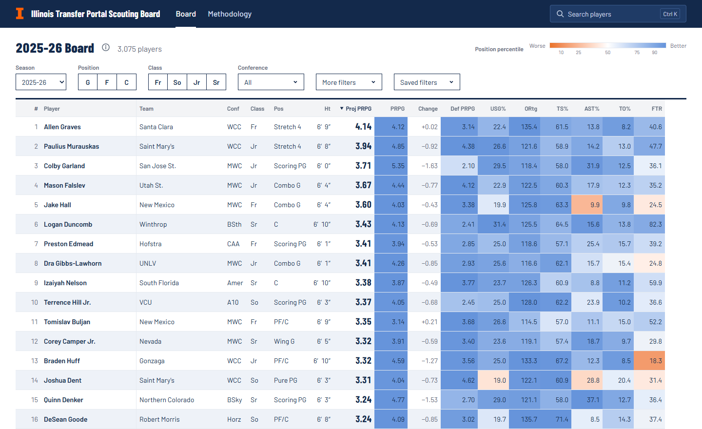
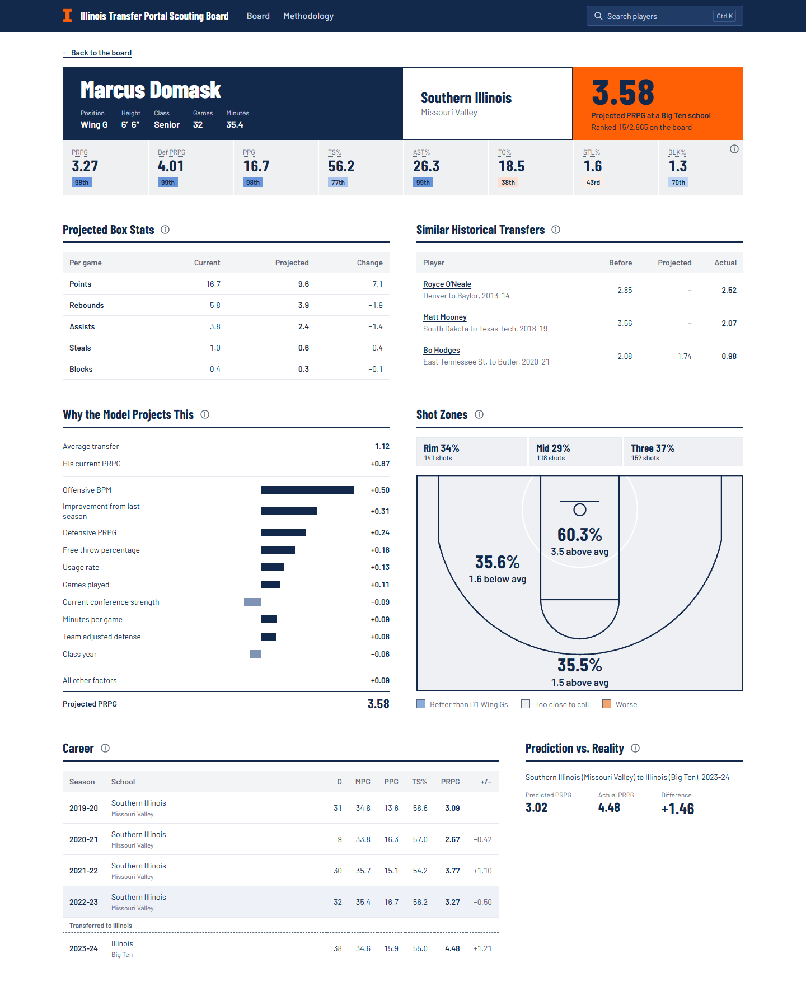
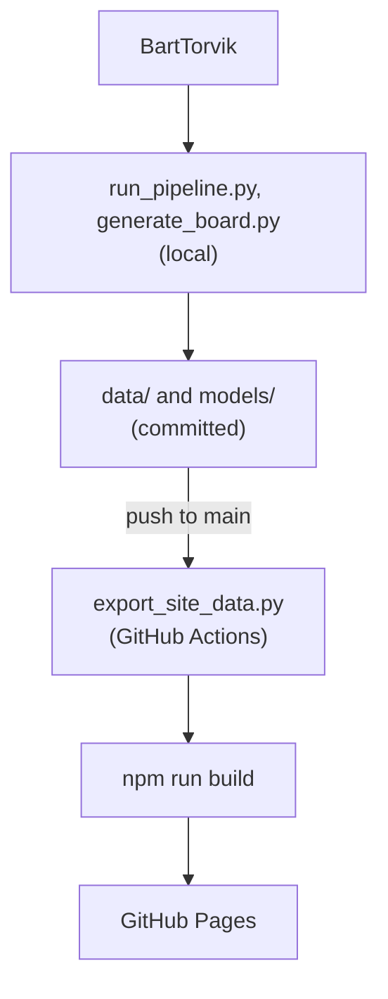

# Mid-Major Recruiting

A scouting board that projects how every D1 player outside the high-majors would produce at Illinois, a Big Ten program, and ranks them by that projection.

**Live site:** https://austindinhh.github.io/mid-major-recruiting/



## The Idea

Raw numbers don't carry over between levels. Scoring 18 points a game in the Sun Belt is worth less than 18 in the Big Ten, and a staff working the transfer portal has hundreds of players to sort through each spring.

Transfers make the translation learnable. A player who moves from a mid-major to a high-major is the same person playing at two levels, and that has happened thousands of times. The model learns from 8,449 of those moves, 2012 to 2026, how production changes with the size of the jump, then applies it to every current player.

## The Site

| Page | What it shows |
| --- | --- |
| Board | Every D1 player with at least 10 games this season, ranked by Projected PRPG. Filter by season, conference, position and class, sort any column, and save filter sets in the browser. Stat cells are shaded by percentile at the player's position. |
| Player | Projected box stats, the three most similar past transfers and how they did, what drives the projection, shot zones against the D1 average at his position, and a season-by-season career log. Players who already moved up also get the model's prediction next to what happened. |
| Methodology | How the model works and how often it is right, written for coaches. |



## Key Metric: PRPG

PRPG is BartTorvik's [points over replacement per game](https://barttorvik.com/porpagatu.html): how many points a game a player adds on offense over a replacement-level player. Def PRPG is the same idea on defense.

| PRPG | Role |
| --- | --- |
| Below 0 | Below replacement |
| 0 to 1 | End of the bench |
| 1 to 2 | Rotation player |
| 2 to 3 | Starter |
| 3 and up | Star |

Projected PRPG is the model's estimate for a player's first season at a team in an average high-major conference. Separate models project points, rebounds, assists, steals and blocks the same way.

## Model

The projection is a LightGBM model with 30 inputs in eight groups: production (including improvement from last season), team and level of competition (including the size of the jump), role, scoring and shooting, profile (height, position, class, recruiting rank), playmaking, rebounding and defense. The player page explains each projection with SHAP values.

Every model is scored with 5-fold cross-validation grouped by player, so no player appears in both training and test:

| Model | MAE (PRPG) | RMSE |
| --- | --- | --- |
| No change (PRPG stays flat) | 1.012 | 1.324 |
| Ridge regression | 0.851 ± 0.009 | 1.082 |
| LightGBM | **0.846 ± 0.011** | 1.081 |

LightGBM's typical miss is 16% smaller than assuming production stays flat. Ridge comes close, so most of the signal is close to linear; the site uses LightGBM for its small edge and its per-player SHAP explanations.

Similar transfers are the nearest past movers by weighted distance on scaled stats. A shot zone is marked better or worse only when his gap from the position average is bigger than one standard error of luck on his number of shots there.

## Data

- Player and team stats from [BartTorvik](https://barttorvik.com)
- 15 seasons, 2011-12 through 2025-26
- 72,321 player-seasons from 28,693 players
- 8,449 transfers for training, counted when a player's school changes between seasons (renamed schools count as one school)
- Board players need at least 10 games that season

## Project Structure

The pipeline runs locally and its outputs are committed. On every push to `main`, GitHub Actions turns them into the site's JSON, builds the site and deploys it.



```
src/                Python pipeline: fetch, features, model, scouting helpers
scripts/            run_pipeline.py, generate_board.py, export_site_data.py
data/, models/      parquet cache and trained models (committed)
web/                the site: Vite, React, TypeScript
.github/workflows/  deploy-site.yml builds and deploys the site on every push to main
```

## Getting Started

### Prerequisites

- Python 3.14
- Node 24

### Run the Site Locally

The data and models are committed, so the site only needs the export step:

```bash
pip install -r requirements-site.txt
python scripts/export_site_data.py   # writes web/public/data, about 145 MB, takes about 2.5 minutes

cd web
npm ci
npm run dev                          # http://localhost:5173/mid-major-recruiting/
```

### Refresh the Data

```bash
pip install -r requirements.txt
python scripts/run_pipeline.py       # fetch BartTorvik data, build features, train
python scripts/generate_board.py     # saved predictions for past transfers
```

Commit `data/` and `models/` and push to `main`. The deploy workflow runs the export, builds the site and publishes it to GitHub Pages. After retraining, set the versions in `requirements-site.txt` to the ones that trained the models, since the saved models may not load under other versions.

## Limitations

- True freshmen aren't on the board, because the model needs a college season to project from.
- Projections for big jumps are less certain. Few past players moved from the bottom of D1 to the top.
- Fit isn't modeled. The projection covers production, not scheme, role or personality.
- Redshirt years aren't tracked, so remaining eligibility can be off.
